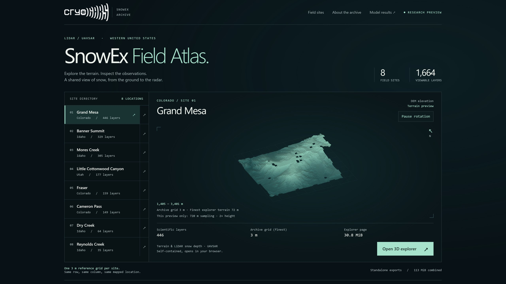
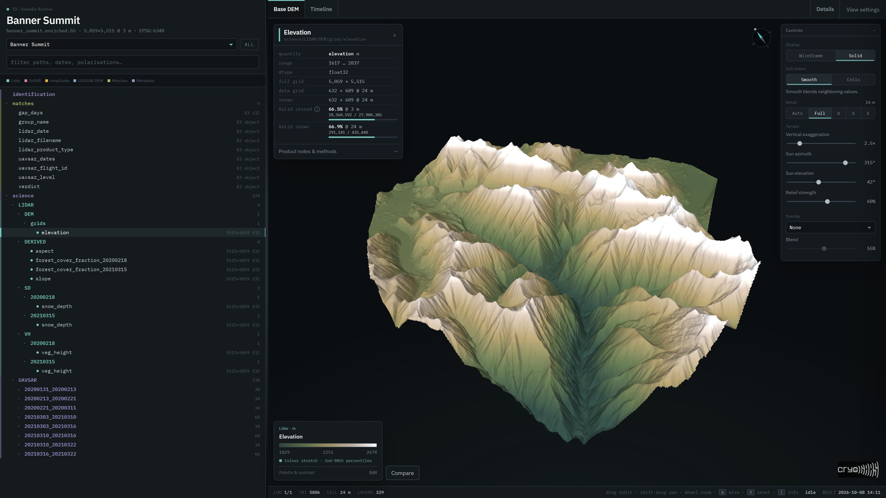
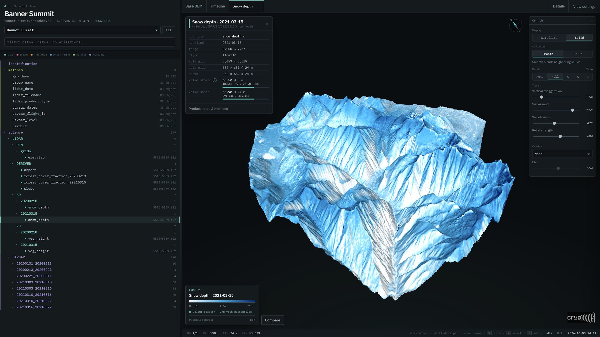
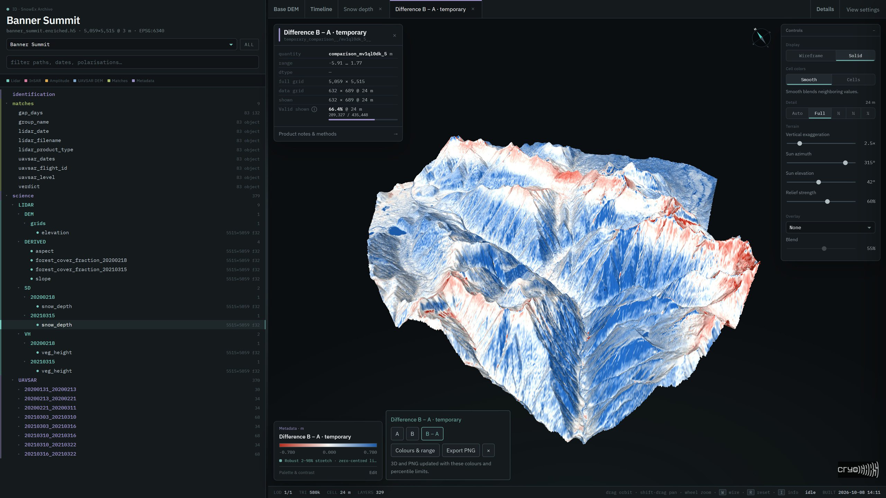
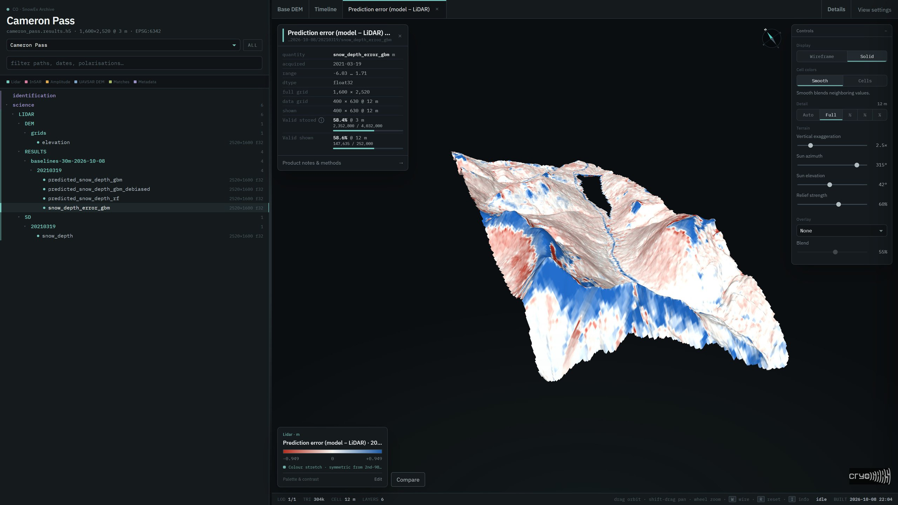

<p align="center">
  
</p>

# SnowEx Field Atlas

**Explore aligned LiDAR and UAVSAR observations, compare snow products, and
inspect the data behind them.**

Built by **Anant Gahlaut** at [CryoGARS](https://github.com/cryogars),
Cryosphere, Geophysics and Remote Sensing research lab, Boise State University.

**Research preview · 8 field sites · 1,664 display layers**

Release **v1.0.05** · enrichment 3.3.0 · MIT licensed.

[Viewer](#viewer) · [Get the archive](#get-the-archive) ·
[Status](#status) · [Model results](#model-results)

**[Open the 3D Atlas →](https://anantgahlaut.github.io/cryogars-atlas-viewer/)** ·
**[Open the model results →](https://anantgahlaut.github.io/cryogars-atlas-results/)**

## Viewer

### [Open the 3D Atlas →](https://anantgahlaut.github.io/cryogars-atlas-viewer/)

Choose a site and open its explorer. No sign-in, Python installation, or HDF5
download is required. Use a modern WebGL-capable browser; desktop viewing is
recommended.



*The Atlas home page with Grand Mesa selected: the site directory, a rotating
elevation preview, and the link to that site's 3D explorer.*



*Banner Summit elevation in the 3D explorer, with a 2nd–98th percentile colour
stretch. The data tree, colour legend, and comparison controls remain available
beside the map.*

### What it does

- **Explore the observations in 3D.** View terrain, LiDAR snow depth and vegetation
  height, UAVSAR amplitude, coherence, phase, and available derived products.
- **Find the right layer.** Search the archive hierarchy, switch sites, and use
  the acquisition timeline to inspect survey dates and radar pairs.
- **Inspect context and methods.** Open product information and notes for units,
  grid spacing, data availability, source information, equations, and limitations.
- **Control the display.** Blend overlays, adjust terrain detail and lighting,
  choose palettes and colour stretches, and save custom palette presets by
  product type. Choose Smooth interpolation or Cells averaging at the selected
  Detail spacing, with one colour per displayed block.
- **Compare two products.** Select another same-product layer or temporarily
  import a numeric GeoTIFF. Switch between reference **A**, comparison **B**,
  and **B − A** on the existing 3D terrain.
- **Export a 2D figure.** Choose comparison colours and percentile limits, then
  export a north-up PNG with its legend, source labels, comparison direction,
  coordinate system, and analysis-grid resolution.

Imported GeoTIFFs and comparison results stay in the visitor's browser. They
are not uploaded or added to the permanent archive.



*Banner Summit LiDAR snow depth, 2021-03-15, with a 2nd–98th percentile colour
stretch.*



*An actual browser comparison at Banner Summit: A = LiDAR snow depth on
2021-03-15; B = the snow-depth prediction from the 30 m random forest benchmark,
imported as a GeoTIFF. The model never saw Banner Summit during training. Blue
is where the model predicts more snow than the LiDAR measured, red is less. The
screenshot uses a robust 2nd–98th percentile colour stretch with symmetric
difference limits. This is an exploratory comparison on the explorer's 24 m
display grid, not the formal evaluation.
**More details: [model results →](https://anantgahlaut.github.io/cryogars-atlas-results/)***

### How it works

1. **Prepare a common reference grid.** The pipeline reprojects and resamples
   accepted rasters onto each site's 3 m DEM reference grid and stores the
   aligned layers, coordinates, dates, and metadata in HDF5. The same row and
   column represent the same mapped location across aligned raster layers.
2. **Create a browser-sized export.** The exporter samples and quantizes display
   arrays, then embeds them with the application in a self-contained HTML page.
   The browser does not read or download the full HDF5 archive.
3. **Render and compare locally.** WebGL draws a DEM-based terrain mesh and
   colours it with the selected product. Automatic terrain detail adapts the
   mesh to the view; it does not increase the underlying data resolution.
   Comparisons align B to A's exported grid and use their shared valid cells.

The **archive grid, exported colour grid, and displayed terrain mesh are
different resolutions**. A 3 m common grid does not create native 3 m radar
information or guarantee common dates, vertical datums, or measurement accuracy.
Current website colour values are 8-bit quantized, and some products have clipped
tails. Comparison PNGs use the exported analysis grid, not the original 3 m
archive or a perspective screenshot. Colour stretches change appearance, not
the comparison's underlying samples or statistics.

Use the full archive for quantitative modeling. Read the
[comparison guide and limitations](docs/BROWSER_COMPARISON.md) and
[scientific notes](docs/scientific-notes.md) before interpreting differences.

The eight explorer pages total approximately **114 MiB**; larger sites can take
longer to load. Application code and display data are embedded. Optional Google
Fonts have local fallbacks.

<details>
<summary>Field sites and current viewer coverage</summary>

| Site | State | Snow-depth dates | Vegetation-height dates | Radar groups | Display layers |
| --- | --- | ---: | ---: | ---: | ---: |
| Grand Mesa | Colorado | 6 | 2 | 27 | 446 |
| Banner Summit | Idaho | 2 | 2 | 11 | 329 |
| Mores Creek | Idaho | 2 | 2 | 10 | 305 |
| Little Cottonwood Canyon | Utah | 1 | 1 | 6 | 177 |
| Fraser | Colorado | 2 | 2 | 5 | 159 |
| Cameron Pass | Colorado | 1 | 1 | 5 | 149 |
| Dry Creek | Idaho | 1 | 1 | 2 | 64 |
| Reynolds Creek | Idaho | 0 | 1 | 1 | 35 |
| **Total** | **3 states** | **15** | **12** | **67** | **1,664** |

These counts describe the published viewer snapshot, not incoming data awaiting
integration. Dates are counted within each site. Radar groups are
site/date-pair/flight-line combinations; shared flights can appear at multiple
sites. Display layers include radar channels and derived products, not just
independent observations. Reynolds Creek currently supplies terrain,
vegetation, and radar context, but no LiDAR snow-depth labels in this snapshot.

</details>

## Get the archive

The full-resolution analysis archive is separate from the browser viewer and
this source repository. It contains per-site HDF5 files with aligned LiDAR and
UAVSAR products, a common 3 m grid, temporal match tables, and processing metadata.

Rather than host about 290 GB, the repository rebuilds the archive from the
original NASA products into any folder you choose:

```bash
conda env create -f environment.yml && conda activate snowex-atlas
python get_dataset.py --dest /path/to/snowex --plan      # sizes only
python get_dataset.py --dest /path/to/snowex             # all eight sites
python get_dataset.py --dest /path/to/snowex --sites cameron_pass
```

It needs a free [NASA Earthdata login](https://urs.earthdata.nasa.gov/) in
`~/.netrc` (Windows: `~/_netrc`). It downloads the exact granules recorded in the
v1.0.05 archive (`snowex_inventory.json`), builds `<site>.h5`, enriches it to
`<site>.enriched.h5`, re-verifies the enrichment and writes SHA-256 manifests.
Interrupted runs resume. Rebuilt files match the published archive dataset by
dataset; they are not byte-identical, because HDF5 records creation times and
software versions.

Grand Mesa alone is about 220 GB; `--plan` reports the space each site needs.

### What is inside

- **LiDAR:** terrain elevation, dated snow-depth and vegetation-height layers.
- **UAVSAR:** available polarizations, amplitudes, coherence, interferograms,
  unwrapped phase, and approximate geometry.
- **Derived layers:** slope, aspect, vegetation-height-based canopy fractions,
  and coherence masks, with product-specific qualifications.
- **Context:** CRS and affine transforms, source identifiers, survey/date-pair
  information, radar–LiDAR matches, and processing metadata.

Product availability varies by site. Base `<site>.h5` files are already aligned
and processed; `<site>.enriched.h5` files contain the enrichment stage. Neither
should be described as untouched sensor data.

<details>
<summary>HDF5 layout and a small Python example</summary>

```text
identification/                       site, grid, and processing metadata
matches/                              LiDAR–radar matching records
science/
  LIDAR/
    DEM/grids/elevation
    SD/<survey_date>/snow_depth
    VH/<survey_date>/veg_height
    DERIVED/
  UAVSAR/
    <date1>_<date2>/<flight_line>/
      <polarization>/
      GEOMETRY/
```

Read a small window without loading an entire site:

```python
import h5py

with h5py.File("path/to/archive/banner_summit.enriched.h5", "r") as archive:
    info = archive["identification"].attrs
    print("CRS:", info["common_crs_epsg"])
    print("Grid:", info["common_grid_shape"])

    surveys = archive["science/LIDAR/SD"]
    survey_date = sorted(surveys.keys())[0]
    depth = surveys[survey_date]["snow_depth"]
    window = depth[:256, :256]
    print(survey_date, window.shape, dict(depth.attrs))
```

Use the recorded transform and CRS to locate pixels. Preserve missing-value
masks, and keep readers closed while an archive writer is active. See the
[workflow guide](docs/workflows.md) for acquisition, generation, verification,
and building a viewer from an existing archive.

</details>

## Status

**v1.0.05, released 2026-10-08:** all eight sites re-enriched to version 3.3.0
and the explorers exported from them. See the [release notes](CHANGELOG.md).

### Known limitations

| Area | Limitation |
| --- | --- |
| Labels | Only ten independent snow-on LiDAR dates archive-wide; Reynolds Creek has none. Label uncertainty is not established. |
| Radar geometry | Incidence is approximate: straight-track, constant-altitude platform; navigation and height compatibility unverified; no terrain occlusion. |
| Vertical reference | Six sites NAVD88/GEOID12b, Grand Mesa WGS84 ellipsoidal, Reynolds Creek unresolved; no conversion is applied. |
| Grand Mesa SWE/density | Two measured IOP rasters specified by the builder are not in this release. |
| Rebuilding | `get_dataset.py` depends on ASF's original UAVSAR URLs, which still redirect after ASF's 2026 reorganisation; fresh catalogue discovery needs a builder update. |
| Incoming ASO data | Deferred; georeferencing, date, duplicate and SWE-lineage issues must be resolved before ingestion. |

The full list, with the reasoning behind each, is in the
[technical reference](docs/technical-reference.md#accepted-limitations-for-v1005).

## Model results

### [Open the model results →](https://anantgahlaut.github.io/cryogars-atlas-results/)

The archive is the training and test data for snow-depth models. The first
baselines, random forest and gradient boosting, predict LiDAR snow depth from
terrain, vegetation and UAVSAR features. Each is tested on a site it never saw
during training (leave-one-site-out), at block sizes from 3 m to 99 m.

On unseen sites, mean R² falls from −0.1 at 3 m to −0.5 at 99 m, while a random
pixel split scores 0.54 to 0.78. The models beat predicting the training sites'
average depth by only about 12% in RMSE: they capture part of the spatial
pattern but miss each site's overall depth, and terrain explains far more than
radar. The results site has the
predictions, error maps, feature importance and every training run; the code is in
the [results repository](https://github.com/AnantGahlaut/cryogars-atlas-results).



*Cameron Pass in the model results viewer: prediction error (model − LiDAR snow
depth) for 2021-03-19 from the 30 m gradient boosting model, trained on the
other six sites. Blue is where the model predicts more snow than the LiDAR
measured, red is less; the colour stretch is symmetric from the 2nd–98th
percentiles. At this site the RMSE is 0.39 m, the bias −0.07 m and the
correlation 0.54.*

No model in this release is a validated snow-depth or SWE retrieval.

## Documentation and attribution

[Documentation index](docs/README.md) ·
[Design document](docs/design.md) ·
[Technical reference](docs/technical-reference.md) ·
[Comparison guide](docs/BROWSER_COMPARISON.md) ·
[Scientific notes](docs/scientific-notes.md) ·
[Data sources](docs/data-sources.md) ·
[Workflow guide](docs/workflows.md) ·
[Release notes](CHANGELOG.md)

Observations are provided by the NASA SnowEx community, NASA/JPL UAVSAR, and
the NSIDC, ASF, and ORNL archives. Cite the original datasets and identify the
site, dates, subset, and processing version used in your analysis.

**Code license: [MIT](LICENSE).** Cite this software with
[CITATION.cff](CITATION.cff). Source datasets retain their own attribution and use
requirements. Developed in the CryoGARS lab with HP Marshall. The
[source repository](https://github.com/cryogars/cryogars-atlas),
[viewer distribution](https://github.com/AnantGahlaut/cryogars-atlas-viewer),
[hosted Atlas](https://anantgahlaut.github.io/cryogars-atlas-viewer/) and
[model results](https://anantgahlaut.github.io/cryogars-atlas-results/) are public.
